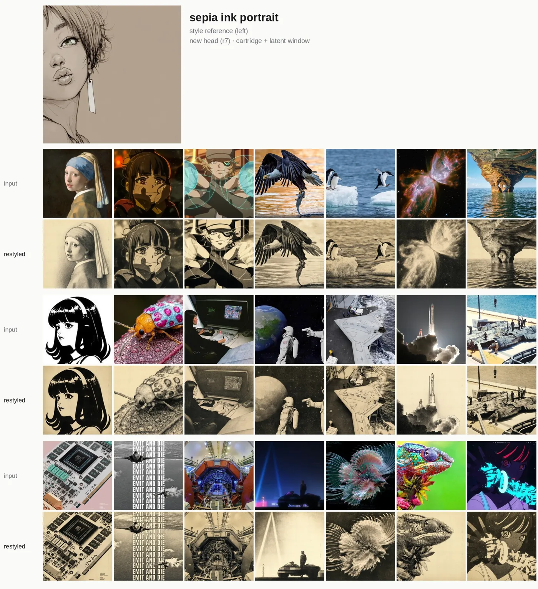
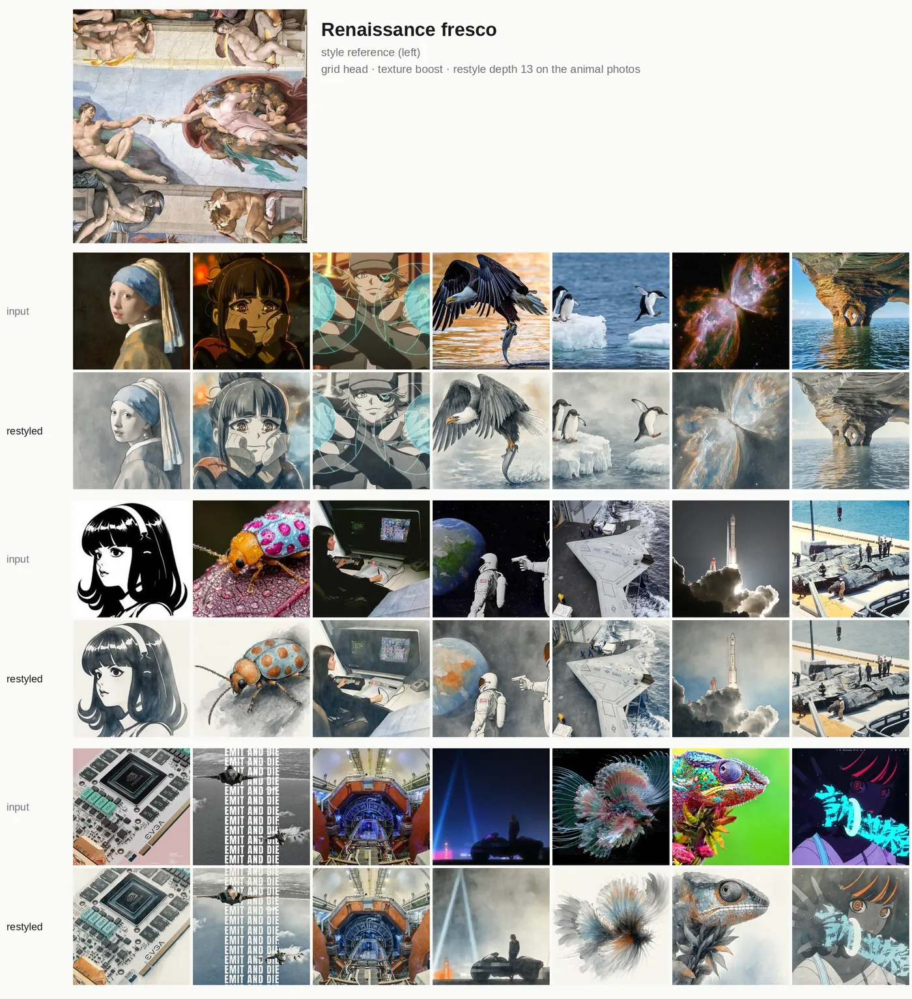
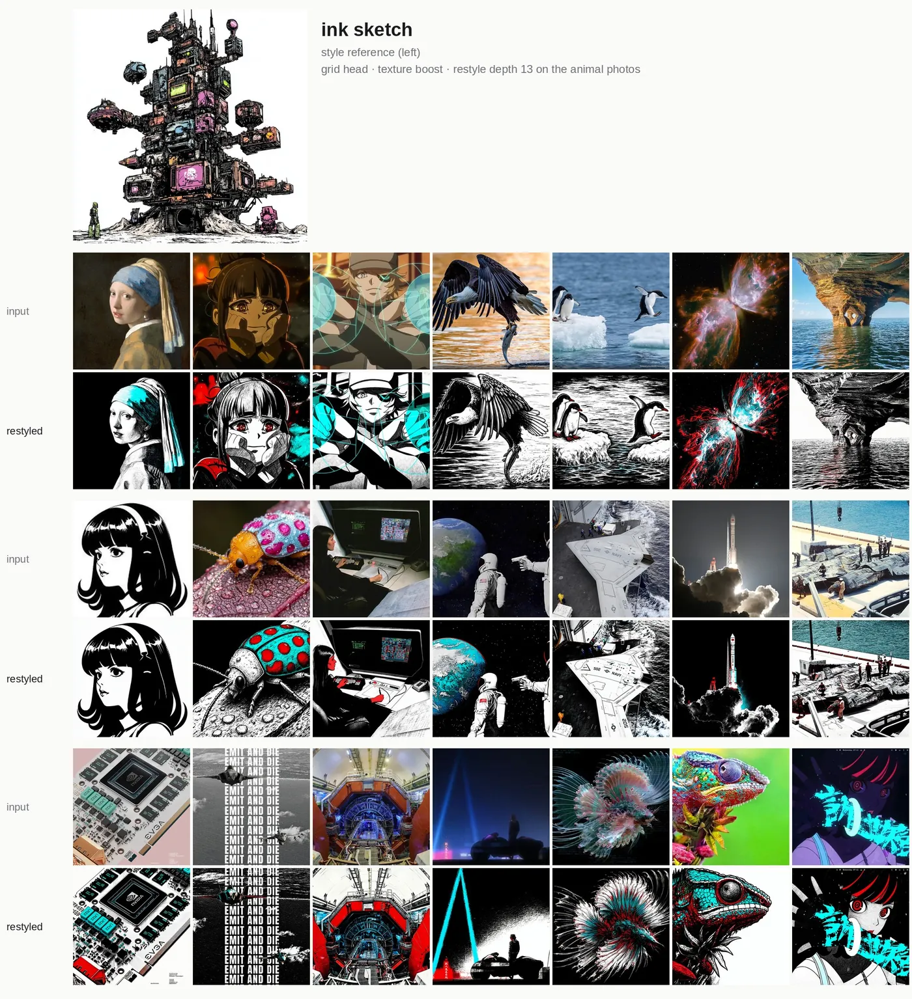
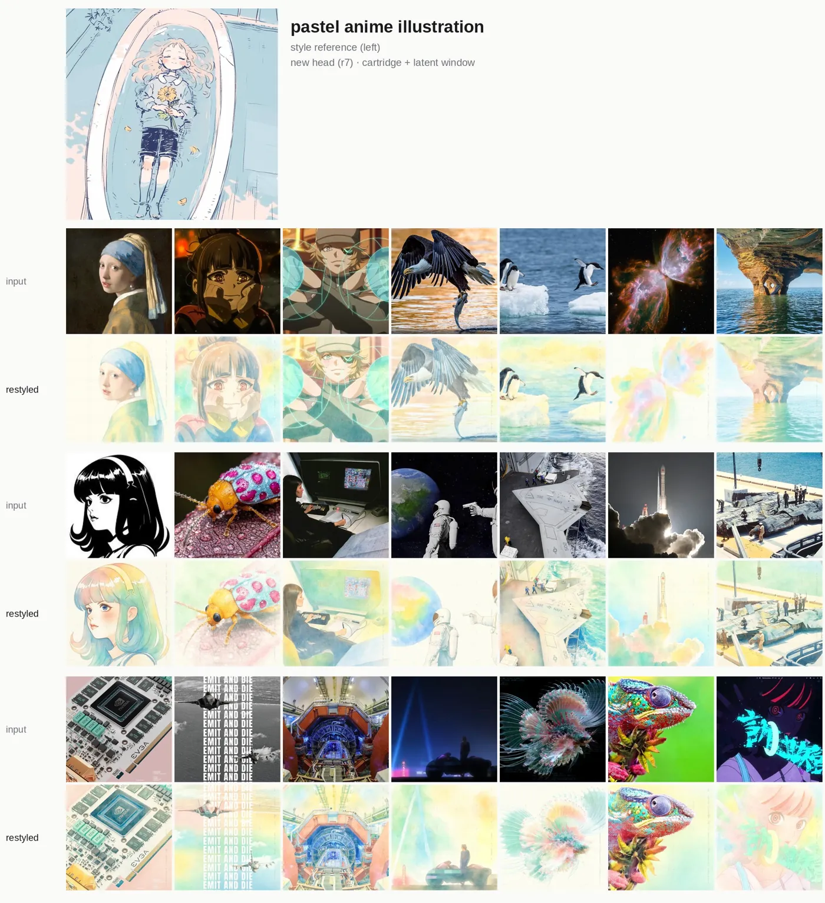
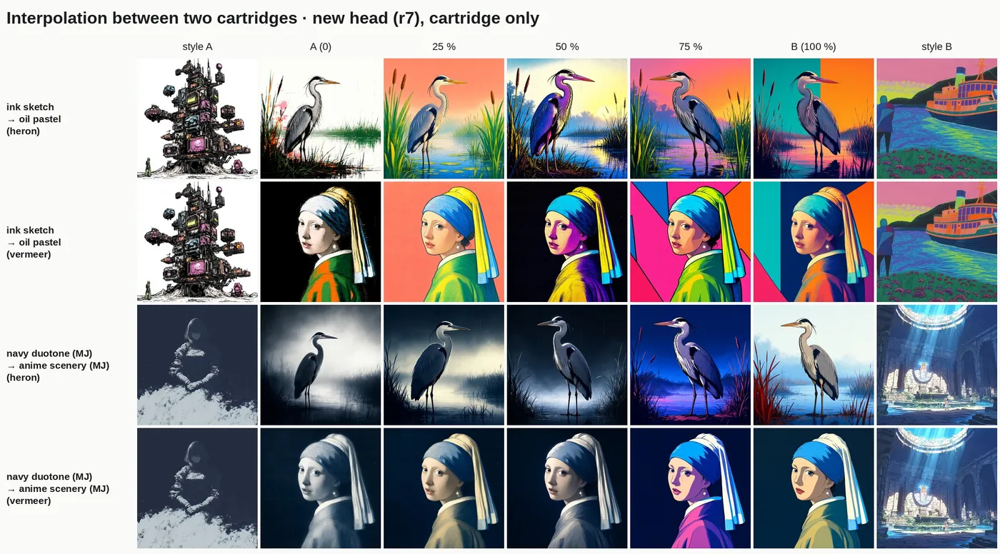
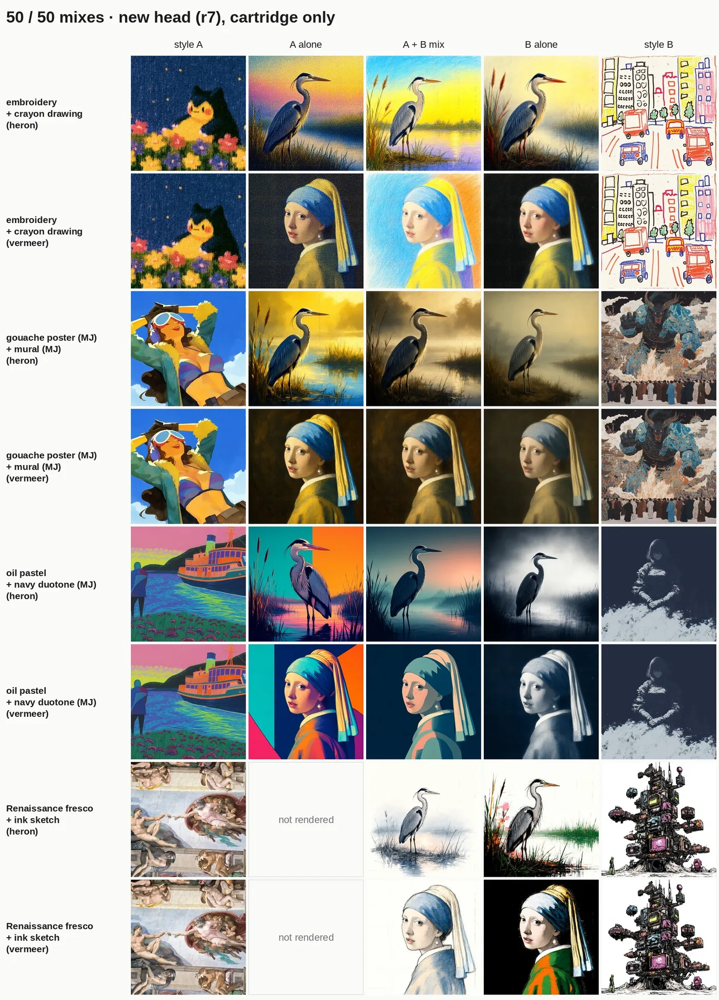

# chameleon
an experiment to create style cartridges for image generation/editing with Qwen-Image 2.1 Turbo (inspired by Midjourney's `--sref`).
It takes in style reference/images as input, passes it to Megastyle encoder, which gives us the style embedding (reusable/controllable cartridge). this is passed to a small describer AR head which writes that style out as a short description (the cartridge), which Qwen-Image then follows for new generations or for restyling given images.

```
style reference ─► MegaStyle encoder ─► style embeddings(cartridge) ─► describer head (trained) ─► style tokens(blended in qwen token space) ─► Qwen-Image 2.1 Turbo
```

Cartridges can be saved (~1 KB), mixed and interpolated, and style strength can be dialed up, which allows for better control (over methods like LoRA). By default, a *texture boost* (latent window) also shows Qwen-Image the style reference latents itself, in DiT blocks 12-19 only, which adds more texture/nuance without copying its subject.

Nature photos (fur, feathers, scales) tend to keep their photographic look. For those, an optional *restyle depth* (`depth=13`) lets Qwen-Image see the photo only in DiT blocks 0-13, so its surface gets redrawn in the new style while the pose and layout stay. It is off by default, because it also changes faces, expressions and lettering.

Training the AR head took about 28 minutes on one A100, after style feature extraction. the Megastyle encoder is basically siglip tuned on Megastyle dataset, repo -> [Gaojunyao/MegaStyle](https://huggingface.co/Gaojunyao/MegaStyle). 



## usage

- [colab notebook](https://colab.research.google.com/drive/1qReAl3VY5_NmbOy-5agauQjncgKJ4mPN?usp=sharing) just like the good ol' clip diffusion days, (runs on a 24 GB GPU such as an L4, or an A100).
- local usage:

```python
from huggingface_hub import hf_hub_download
from chameleon import serve

pipe = serve.Pipeline(hf_hub_download("tensorkelechi/chameleon-ar-head", "head_pre.pt"), None)
cart = pipe.make([style_image], ["my-style"])                     # one cartridge from one or more images
text, out = pipe.run(cart, ["a lighthouse on a rocky coast"], [photo], ref=style_image)
mixed = pipe.mix([cart_a, cart_b], [0.5, 0.5])                    # mixing and interpolation
```

`text` is the style description generated by chameleon's AR head; `out` holds (label, image) pairs, with and without texture boost.


## Links

- describer head: [tensorkelechi/chameleon-ar-head](https://huggingface.co/tensorkelechi/chameleon-ar-head)
- style labels dataset: [tensorkelechi/chameleon-style-labels](https://huggingface.co/datasets/tensorkelechi/chameleon-style-labels)

## sample outputs
Some restyled samples can be visualized here: [Chameleon showcase](https://claude.ai/artifact/CqQjJsQ1nsJfTNaPFKXY1y).







### interpolation and mixing






## Licences
The head is trained on MegaStyle-1.4M, which is released for research use, so chameleon is for research and
non-commercial use. Qwen-Image 2.1 Turbo, the MegaStyle encoder and Qwen3-4B (only its token-embedding matrix is
used) are under their own licences.
