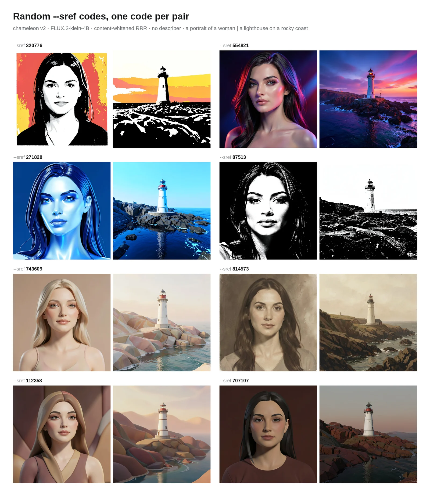
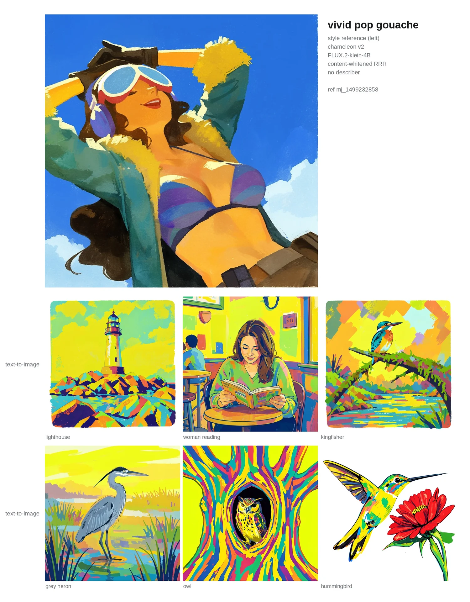
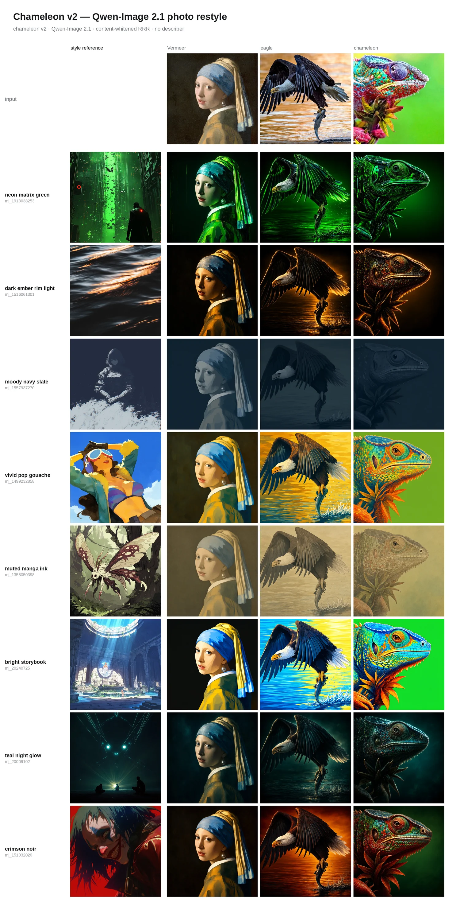

# chameleon

Zero-describer `--sref` style cartridges for **FLUX.2-klein-4B** and **Qwen-Image 2.1 Turbo**, fitted by content-whitened supervised reduced-rank regression.

Takes a reference image (or an integer `--sref` seed) directly to a compact `128`-D style code `z` and a soft style token block appended after the prompt—no autoregressive describer, no DiT or LoRA weight edits.



> **v1 (AR describer)** lives on the [`v1`](../../tree/v1) branch (`head_grid.pt`, Colab notebook, Gradio Space).

## How it works

```
reference image ─► MegaStyle SigLIP (1152-d) ─► content-whitened RRR (128-d z) ─┐
                                                                                 ├─► mu + alpha * z @ basis ─► [prompt ; style] ─► frozen DiT
--sref seed     ─► N(0, 1)^128 * sd ─────────────────────────────────────────────┘
```

1. **Content-whitened fit.** On 19,000 MegaStyle styles (8 images per style), pooled SigLIP embeddings are regressed onto VLM style descriptions in each DiT's text-conditioning space. Because the image-side Gram matrix sums over all images, ridge regression whitens away within-style subject/content directions; SVD of the whitened map yields an orthonormal rank-`128` style basis (`K = 64` × `7680` for Klein; `K = 96` × `4096` post-`txt_in` for Qwen).
2. **Image → style code.** At inference, a reference image's pooled embedding maps linearly to `z` and is norm-calibrated (`alpha = 5` on Klein, `alpha = 3` on Qwen), with zero describer overhead.
3. **Random `--sref` & round-trip.** Any integer seed draws `z ~ N(0, 1)^128 * sd`; `sref.nearest_code` recovers the closest integer code for any reference image.



## Results (1024 px, zero describer)

| Benchmark | Qwen v2 | Klein v2 | v1 `r7` (AR head) |
|---|---:|---:|---:|
| 20 MJ `--sref` codes · default / nature (CSD ↑) | `.414` / `.365` | `.361` / `.364` | `.433` / `.390` |
| 10 ceiling codes · default / nature (CSD ↑) | `.436` / `.354` | `.313` / `.329` | `.381` / `.312` |
| Photo edit · 8 codes × 3 targets (CSD ↑ / DINO_fed ↓) | `.404` / `.085` | *pending* | – |
| Random `--sref` · within / between / gap (CSD ↑) | `.558` / `.213` / **`.345`** | `.498` / `.101` / **`.397`** | – |

On the 20 MJ codes, `DINO_fed` (reference copying) stays at `.097` / `.032` (Qwen) and `.099` / `.063` (Klein), well under the `.13` copying bar, while `CLIP-T` prompt adherence holds at `.246`–`.263`. Klein photo editing is pending and will update next.



## Quickstart

Needs a CUDA GPU (`24 GB` VRAM) and `torch`, `diffusers`, `transformers`, `pillow`.

### FLUX.2-klein-4B (4 steps)

```python
from PIL import Image
from torchvision.utils import save_image
from chameleon import klein, sref as sr, sref_klein, style

s = sr.load("sref_klein.npz", "cuda")
k = klein.load(klein.DISTILLED)

# From an integer --sref code
z = sr.z_code(s, 320776)

# Or from one or more style reference images
bb = style.load_backbone()
z = sr.z_image(s, sr.embed(bb, [Image.open("ref.jpg")]))

lat = sref_klein.render(k, "a lighthouse on a rocky coast", s, z, seed=0)
save_image(klein.decode(k, lat, 64), "out.png")
```

### Qwen-Image 2.1 Turbo (8 steps)

```python
from PIL import Image
from chameleon import sref as sr, sref_qwen
from chameleon.qport import model as qm
from chameleon.qport.dit import Hooks

s = sr.load("sref_qwen.npz", "cuda")
enc, proc = qm.load_encoder()
text = qm.encode(enc, proc, "a lighthouse on a rocky coast", [])
core = qm.load_core()

z = sr.z_code(s, 320776)
sref_qwen.render(core, text, s, z, seed=0).save("out.png")

# Photo restyle (photo_window=(0, 13) keeps pose while redrawing fur/feathers/scales)
photo = Image.open("photo.jpg").convert("RGB").resize((1024, 1024))
edit_text = qm.encode(enc, proc, "Restyle the photo.", [photo])
refs = qm.to_latents(core, [photo])
qm.edit(core, edit_text, refs, [(64, 64)], seed=0,
        hooks=Hooks(style_block=sref_qwen.style_block(s, z), photo_window=(0, 13))).save("edit.png")
```

## Licences

Fitted on [MegaStyle-1.4M](https://huggingface.co/datasets/tencent/MegaStyle-1.4M) (research / non-commercial use) and [`tensorkelechi/chameleon-style-labels`](https://huggingface.co/datasets/tensorkelechi/chameleon-style-labels). FLUX.2-klein-4B, Qwen-Image 2.1 Turbo, and the [MegaStyle encoder](https://huggingface.co/Gaojunyao/MegaStyle) are under their own licences.
